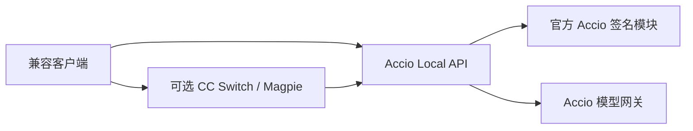

<div align="center">

# Accio Local API

**将自己的 Accio 订阅接入 Claude / OpenAI 兼容客户端**


[快速开始](#快速开始) · [客户端配置](#客户端配置) · [接口](#接口) · [常见问题](#常见问题) · [支持范围](#支持范围与限制)

</div>

在自己的电脑上运行一个仅监听回环地址的 API，通过独立 Accio 登录使用本人可访问的模型和订阅额度。提供 **Anthropic Messages** 与 **OpenAI Chat Completions** 接口，可连接兼容客户端或 CC Switch、Magpie 等网关。

本项目是非官方社区桥接，与 Accio、Alibaba、Anthropic、OpenAI 无隶属关系。使用依赖已安装的官方 Accio 客户端及其原生签名模块；官方程序和原生模块不随仓库分发。请遵守所用服务的条款和账号权限。

## 功能

| 能力 | 说明 |
| --- | --- |
| 双协议 | `/v1/messages`、`/v1/chat/completions`，支持流式文本 |
| 客户端工具 | 转发函数定义、调用及结果；工具在调用端执行 |
| 实时模型目录 | 从当前账号获取可见且未锁定的模型，按真实别名选择 |
| 空间与额度 | 校验独立登录与官方所选空间；区分个人和团队订阅 |
| 本地凭据 | macOS Keychain / Windows DPAPI CurrentUser |
| 认证恢复 | 目录、额度及身份元数据遇认证失效时刷新并重试一次 |
| 并发 | 默认最多 50 个生成请求；原生签名最多 2 个子进程，其他排队 |
| 轻量运行 | 无 npm 运行依赖；Node.js 24+ |



## 快速开始

### 环境要求

| 平台 | 要求与验证边界 |
| --- | --- |
| Windows | x64、PowerShell 5.1+、Node.js 24+；本地适配基于 Accio 0.35.2 |
| macOS | Node.js 24+、系统 Python 3；历史验证为 Apple Silicon、Accio 0.34.5 |
| 账号 | 自行安装官方 Accio，使用自己的账号并选择有效个人或团队空间 |

Intel Mac、Windows ARM、Linux 未验证。官方客户端升级可能改变非公开接口。

```sh
git clone https://github.com/alan113523/accio-local-api.git
cd accio-local-api
npm test
```

### Windows

```powershell
.\install-windows.ps1 -AccioExecutable 'C:\path\to\Accio.exe'
$install = Join-Path $env:LOCALAPPDATA 'Accio Local API'
& (Join-Path $install 'login-windows.ps1')
```

替换官方程序路径，在浏览器亲自完成登录。默认安装到当前用户 LocalAppData，创建登录自启入口。[完整 Windows 操作说明](README-WINDOWS.md)。

### macOS

```sh
node install-mac.mjs
node "$HOME/Library/Application Support/Accio Local API/src/cli.mjs" login
```

打开命令返回的官方登录地址。安装器注册当前用户 LaunchAgent `com.local.accio-api`。

### 检查与获取本机 Key

安装完成后，用安装目录中的 CLI 执行 `status`、`models`、`quota`；`key` 命令显示本人本机 API Key。Windows 示例见上方文档；macOS 示例：

```sh
node "$HOME/Library/Application Support/Accio Local API/src/cli.mjs" status
node "$HOME/Library/Application Support/Accio Local API/src/cli.mjs" models
node "$HOME/Library/Application Support/Accio Local API/src/cli.mjs" quota
node "$HOME/Library/Application Support/Accio Local API/src/cli.mjs" key
```

## 客户端配置

| 配置项 | 值 |
| --- | --- |
| Anthropic Messages base URL | `http://127.0.0.1:18437` |
| OpenAI Chat Completions base URL | `http://127.0.0.1:18437/v1` |
| API Key | CLI `key` 返回的本人本机 Key |
| 模型 | CLI `models` 或 `/v1/models` 返回的完整 `id` |

在客户端新建供应商，填写对应协议、地址和 Key。CC Switch 可按其文档选择路由模式；Magpie 可配置兼容上游。本项目不修改客户端配置。模型目录可见不代表所有模型或功能均做过调用测试。

CC Switch 的每分钟订阅积分查询：[配置说明](docs/CC-SWITCH-USAGE.md)、[查询脚本](examples/cc-switch/accio-usage-query.js)。客户端按价格表估算的金额与 Accio 实际订阅余额是不同指标。

### 请求示例

在终端自行设置 `ACCIO_LOCAL_API_KEY` 和 `ACCIO_MODEL`，模型取自实时目录：

```sh
curl http://127.0.0.1:18437/v1/messages \
  -H "x-api-key: $ACCIO_LOCAL_API_KEY" \
  -H "anthropic-version: 2023-06-01" \
  -H "content-type: application/json" \
  -d "{\"model\":\"$ACCIO_MODEL\",\"max_tokens\":128,\"messages\":[{\"role\":\"user\",\"content\":\"Hello\"}]}"
```

## 接口

| 方法 | 路径 | 用途 |
| --- | --- | --- |
| GET | `/health` | 无需 Key 的健康检查 |
| GET | `/status` | 登录状态、本地生成并发上限与活跃请求数 |
| GET | `/v1/models` | 实时模型目录 |
| GET | `/quota` | 当前所选空间的订阅额度 |
| POST | `/v1/messages` | Anthropic Messages |
| POST | `/v1/chat/completions` | OpenAI Chat Completions |

除健康检查和登录回调外均需 Key；支持 `Authorization: Bearer` 或 `x-api-key`。仅监听 `127.0.0.1`，不开放浏览器跨域访问。

## 支持范围与限制

- 支持文本、流式、客户端函数工具与工具结果；服务本身不执行工具或读取业务文件。
- 支持 OpenAI `reasoning_effort` 及 Anthropic adaptive thinking / `output_config.effort` 映射；不输出思考正文或签名，不支持 `budget_tokens`。
- 不支持 Responses、精确 count_tokens、图片、文档、服务端工具或强制工具选择；不支持的请求会明确报错。
- 默认最多 50 个生成请求，单请求最多 120 秒。生成请求不自动重试；仅认证元数据有一次刷新重试。50 并发是本地限额，不能据此承诺上游吞吐。
- 不添加身份、技能、记忆或规划提示词；上游云端是否添加隐藏内容无法独立证明。`auto_model=false`，不静默切换模型或账号。
- 缺失 usage 时不编造估算；Messages 必填用量为 0 并标记 `accio_usage_unavailable`。
- Cowork、长上下文及完整桌面工具能力未全面验证。macOS 的新版跨平台改动尚未在实机重新验收。

## 常见问题

**出现 `login_required` / `accio_auth_expired`？** 先运行登录命令，用本人账号重新授权。仅 `authenticated: true` 不能证明云端登录仍有效，应同时检查 `models` 和 `quota`。

**出现 `space_account_mismatch` / `official_space_unavailable`？** 在官方客户端选择有效空间，并确保桥接独立登录属于同一账号；不会自动回退到个人池。

**Windows 签名失败？** 检查安装配置中的官方 Accio 路径和客户端版本。直接开发运行时需设置 `ACCIO_DESKTOP_EXE`、`ACCIO_APP_VERSION`、`ACCIO_API_STATE_DIR`；安装后优先使用启动脚本。

**升级如何处理？** macOS 安装器备份并覆盖自有白名单文件；Windows 拒绝覆盖已有目录，安装新目录并重新登录，先保留旧状态。没有自动更新器。

## 开发与验证

```sh
npm test
```

离线测试使用合成账号、凭据与模拟上游，不连接真实模型。Windows DPAPI 测试只使用临时合成数据。[本次发布验证](docs/RELEASE-VALIDATION.md)与[历史 macOS 验证摘要](docs/VALIDATION.json)分开记录。

可选实测会使用本人的订阅额度，需在已配置好本人安装环境的终端手动运行：`node test/live-smoke.mjs`、`node test/live-tool-smoke.mjs`。它们不是默认测试的一部分。

## 安全与分发

仓库只含通用代码、测试和脱敏说明，不包含 API Key、OAuth 凭据、Cookie、账号/团队标识、真实余额、日志、个人配置或官方客户端文件。请勿将运行时 `state/`、`windows-install.json` 或登录链接上传到 Issue。[分发范围](EXCLUSIONS.md)。

`FILES.json` 与 `SHA256SUMS.txt` 记录本次源码快照；macOS/Linux 可运行 `shasum -a 256 -c SHA256SUMS.txt`。清单不包含 Git 元数据及运行数据。

## 贡献与参考

欢迎提交不含真实账号数据的复现步骤与补丁。说明系统、Node.js 和 Accio 版本，使用合成输入，并先运行离线测试。

README 信息结构参考 [CC Switch](https://github.com/farion1231/cc-switch) 与 [CLIProxyAPI](https://github.com/router-for-me/CLIProxyAPI) 的项目介绍、快速开始、配置与文档导航；未复制其实现代码。[协议说明](docs/PROTOCOL-NOTES.md)。
